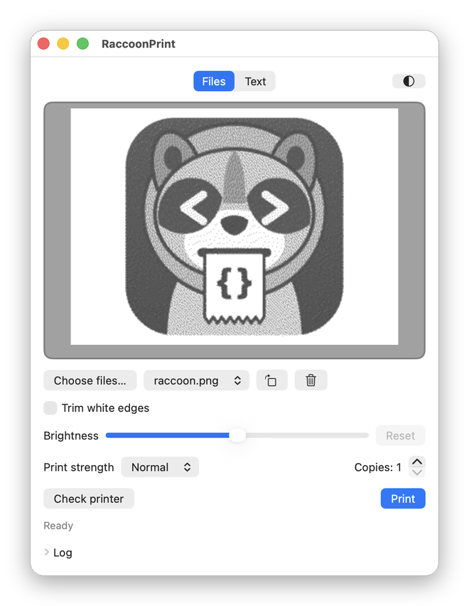
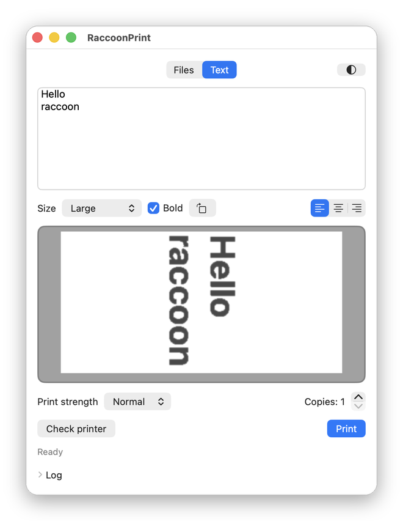
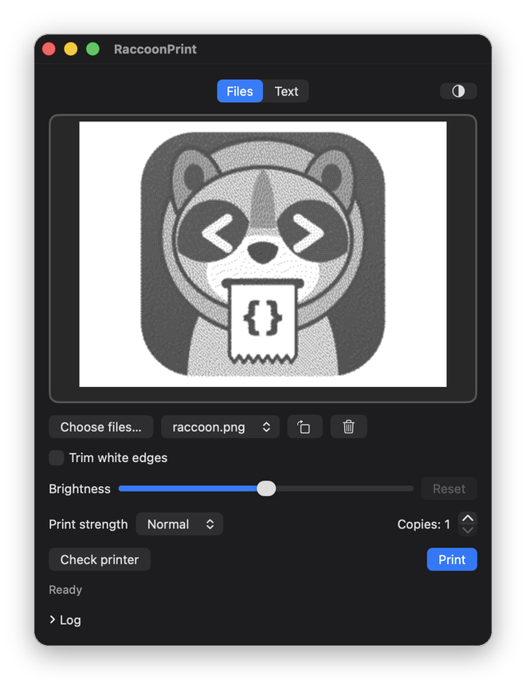

# RaccoonPrint

**Print images, PDFs and text from your Mac to a PeriPage A6, over Bluetooth.** Free, open source, no account, no internet needed.

**[Download the latest version](https://github.com/impascab/raccoonprint/releases/latest)**

Unofficial: not affiliated with or endorsed by PeriPage. The raccoon is a parody.

> [!NOTE]
> All the code in this app was written by Claude (Anthropic's AI). I tested it on a physical PeriPage A6.

| Text, even sideways | Dark theme |
|---|---|
|  |  |

## What it does
- **Images and PDFs:** drag them in, paste them or choose files. PDFs print their first page.
- **Text:** size, bold, alignment, and sideways text along the paper.
- **Preview:** see roughly what will come out before you use paper.
- **Adjust:** rotate, trim white edges, brightness, print strength, copies.
- **Printer check:** battery level and out-of-paper warning.
- **Light and dark themes**, and a log you can copy if something goes wrong.

## Will it work for me?
| You need | Details |
|---|---|
| Printer | **PeriPage A6, 203 dpi, firmware V1.11.** That's the only one we've tested, so it's the only one we expect to work for now. Tried another firmware version? [Tell us if it works](https://github.com/impascab/raccoonprint/issues/new/choose) and I'll add it here. (The app stops with a message if the printer isn't 203 dpi.) |
| Mac | Apple silicon (M1 or newer), macOS 14 or newer |

Not sure which A6 you have? Click **Check printer**: it tells you if yours isn't supported.

## Make it yours
You're welcome to fork, change and share this app under the [GPL-3.0](LICENSE) licence. Want to support another printer? Open a pull request. I'll gladly consider it if you can show it working on your own hardware. See [CONTRIBUTING.md](CONTRIBUTING.md).

## Install
1. Pair the printer in **System Settings > Bluetooth**.
2. Open `RaccoonPrint.dmg` and drag RaccoonPrint to Applications.
3. Open it. macOS will block it the first time, because the app isn't notarized by Apple (that needs a paid account). Go to **System Settings > Privacy & Security** and click **Open Anyway**. Only do this if you trust the source; you can also [build it yourself](#for-developers).
4. Allow Bluetooth when asked.

## If something goes wrong
| Problem | Try this |
|---|---|
| Can't reach the printer | Turn it off and on, keep it close, disconnect it from your phone |
| Out of paper | Load paper, close the lid, print again |
| Uneven white borders, or a long print drifts sideways | Check that the paper roll sits straight; it can be a little loose |
| Print too pale or too dark | Change **Brightness** (the image) or **Print strength** (the heat) |
| Blank paper after Cancel | Normal: it finishes the strip so the next print isn't garbled |

## Good to know
- "Done" means the printer answered after the last row. It can't see the paper itself.
- If paper runs out during a print, the app notices only after sending the current strip (up to about 12.5 cm).
- Images longer than about 12.5 cm pause briefly every 12.5 cm.
- Closing the lid of your Mac can interrupt a print.
- The preview is approximate. Text with emoji has slightly softer edges.

## Privacy and security
Nothing leaves your Mac except the print data sent to the printer. The app runs in Apple's sandbox: it can use Bluetooth and read only the files you choose, and has no network access. The log has no file names or typed text, but does include your printer's Bluetooth name. The app has not been independently audited. Details: [SECURITY.md](SECURITY.md).

## For developers
Needs the Xcode command line tools.

    ./test.sh    # unit tests, no printer needed
    ./build.sh   # creates dist/RaccoonPrint.dmg

Check a download: `shasum -a 256 -c RaccoonPrint.dmg.sha256`. What we learned about the printer is in [CHANGELOG.md](CHANGELOG.md).

## Credits
RaccoonPrint would not exist without these projects. The Swift code was written for RaccoonPrint, using what they worked out:

- **[peripage-python](https://github.com/bitrate16/peripage-python)** by bitrate16 (GPL-3.0): the printer commands used here (reset, print strength, raster, paper feed, battery and device information), the 384-dot A6 settings, and the image preparation steps.
- **[peripage-tool](https://github.com/elkusbry/peripage-tool)** by Bryan Elkus (MIT): sending an image as one continuous raster, the final paper feed, and notes on print speed.
- **[peripage-A6-bluetooth](https://github.com/eliasweingaertner/peripage-A6-bluetooth)** by Elias Weingärtner: the original reverse engineering that peripage-python continues. Not used directly.

Licence texts and notices: [THIRD_PARTY.md](THIRD_PARTY.md). Code written by Claude (Anthropic).

## License
[GPL-3.0](LICENSE)
